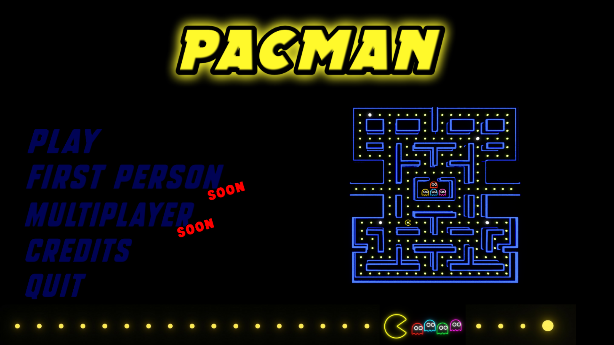
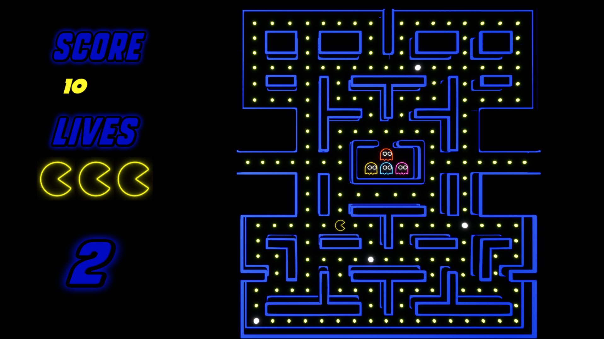
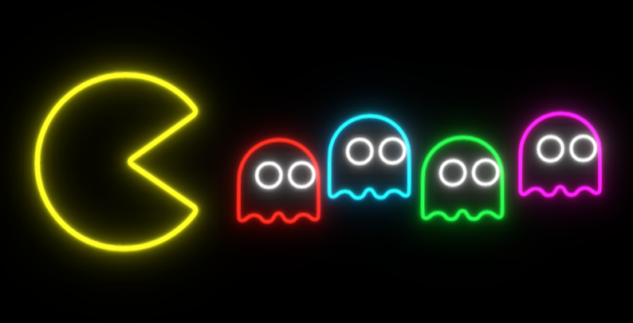
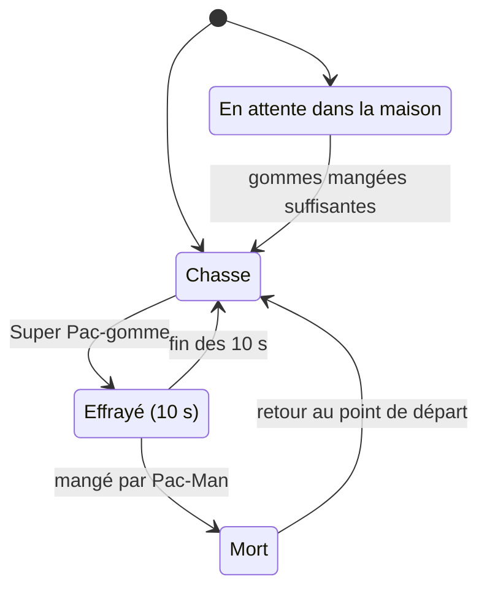

<div align="center">

# 🟡 PACMAN UE5

**Un clone néon de Pac-Man en 3D vue de dessus, avec des fantômes pilotés par Behavior Trees.**


<!-- Ajoute tes captures dans le dossier docs/ -->
  

</div>

---

## 📖 À propos

Projet réalisé dans le cadre du **TP2 du cours d'Intelligence Artificielle pour jeux vidéo** (UQAC). L'objectif : recréer le gameplay de Pac-Man dans Unreal Engine 5, avec une attention particulière sur le **comportement autonome des fantômes** : *Behavior Trees*, *Blackboard*, tâches C++ personnalisées et navigation par **NavMesh**.

Le jeu est en **3D avec une caméra vue de dessus**, dans une ambiance néon (menu animé, HUD stylisé, bande sonore d'origine).

**Developpeur :** `HIE Jean-Baptiste`

---

## ✨ Fonctionnalités

### 🎮 Gameplay
- **Déplacement de Pac-Man sur un graphe de nœuds** (`APacmanNode` : haut, bas, gauche, droite). Virages stricts, **demi-tours instantanés** et **buffer de direction** : la prochaine direction demandée est mémorisée jusqu'au prochain croisement.
- **Tunnel latéral** : téléportation d'un bord à l'autre du labyrinthe.
- **3 vies**, mort animée (Pac-Man rétrécit pendant le son de mort), puis **décompte 3 · 2 · 1 · GO !** avant la reprise.
- **Pac-gommes et Super Pac-gommes** générées par `BP_PacGommeSpawner`.
- **Écran de victoire** quand toutes les gommes sont mangées, **écran de Game Over** à la dernière vie.

### 👻 Intelligence artificielle
- **4 fantômes, 4 personnalités** inspirées du jeu original.
- **Machine à états pilotée par Behavior Tree** : Chasse, Fuite, Retour à la base.
- **Sortie échelonnée de la maison** selon le nombre de gommes mangées.
- **Nav Link** pour franchir la porte de la maison des fantômes.

### 🖥️ Interface
- **Menu principal** : Play, Credits, Quit (First Person et Multiplayer marqués *SOON*). Chaque bouton est un **néon qui s'allume au survol**.
- **HUD** : score et vies avec police arcade (*Megalopolis X*) et titres lumineux.
- **Écrans** : décompte, Game Over, Victoire, Crédits.

### 🔊 Audio
- Son de gomme en boucle tant que Pac-Man mange (il s'arrête dès qu'il arrête de manger).
- Sirène des fantômes en boucle, remplacée par le son « fantômes bleus » pendant la fuite.
- Sons dédiés : fantôme mangé, Super Pac-gomme, mort de Pac-Man, clic de menu.

---

## 👻 Les fantômes

| Fantôme | Personnalité | Cible en mode Chasse | Sortie de la maison |
|---|---|---|---|
| **Blinky** 🔴 | Agressif | Directement Pac-Man | Dehors dès le départ |
| **Pinky** 🩷 | Embuscade | **4 cases devant** Pac-Man | Immédiate |
| **Inky** 🩵 | Imprévisible | Pivot à 2 cases devant Pac-Man, puis **vecteur Blinky → pivot doublé** | Après **30** gommes |
| **Clyde** 🟠 | Timide | Pac-Man s'il est loin, **son coin** s'il est à moins de 8 cases | Après **60** gommes |

> Après une mort de Pac-Man, les seuils de sortie baissent (Pinky **7**, Inky **17**, Clyde **32**), comme dans le jeu original.

### États d'un fantôme



- **Effrayé** : vitesse réduite (×0,66), déplacements aléatoires sur le NavMesh, apparence bleue.
- **Mort** : vitesse doublée, apparence blanche, retourne au point de départ puis redevient normal.
- **Chasse** : le fantôme tue Pac-Man au contact.

### Behavior Tree

Les quatre arbres partagent la même structure. Seule la tâche de la branche Chasse change selon le fantôme.

```
ROOT (Blackboard : IsDead, IsFrightened, TargetLocation)
└─ Selector
   ├─ [IsDead is Set · aborts both]        Sequence « Mort »
   │     Find Respawn Point → Move To → Set Alive Mode
   ├─ [IsFrightened is Set · aborts both]  Sequence « Fuite »
   │     Find Frighten Position → Move To → Wait
   └─ [ni mort ni effrayé · aborts self]   Sequence « Chasse »
         Find <Blinky | Ambush | Inky | Clyde> Position → Move To
```

---

## 🏗️ Architecture technique

| Classe | Rôle |
|---|---|
| `APacmanPawn` | Déplacement sur graphe, score, vies, sons, séquence de mort, décompte, victoire |
| `APacEntity` | Classe de base commune (`APawn` + `UFloatingPawnMovement`) |
| `AGhost` | États (vivant / effrayé / mort), timer de fuite, vitesses, sortie de la maison, événement `OnModeChanged` pour l'apparence |
| `AAIControllerBase` | Lance le Behavior Tree, synchronise le Blackboard, met l'arbre en pause (fantôme en attente) |
| `AEatable` → `ASuperPacGome` | Éléments mangeables ; la Super Pac-gomme déclenche la fuite |
| `APacmanNode` | Nœud du graphe de déplacement de Pac-Man |

**Tâches Behavior Tree (C++)**

| Tâche | Fonction |
|---|---|
| `UBTTaskNode_FindAmbushPosition` | Cible de Pinky (devant Pac-Man) |
| `UBTTaskNode_FindInkyPosition` | Cible d'Inky (vecteur Blinky → pivot) |
| `UBTTaskNode_FindClydePosition` | Cible de Clyde (et de Blinky avec un seuil à 0) |
| `UBTTaskNode_FindFrightenPosition` | Destination aléatoire en mode fuite |
| `UBTTaskNode_FindRespawnPoint` | Point de départ du fantôme mort |
| `UBTTaskNode_SetAliveMode` | Remet le fantôme en mode normal |
| `UBTTaskNode_ChasePlayer` | Déplacement vers la cible du Blackboard |

**Widgets (UMG)** : `WBP_Menu`, `WBP_HUD`, `WBP_Countdown`, `WBP_GameOver`, `WBP_Victory`, `WBP_Credits`.

### 💡 Quelques choix techniques

- **Décompte sans pause du monde** : `SetGamePaused` bloque aussi l'interface. Pac-Man et les fantômes sont donc figés avec `CustomTimeDilation`, ce qui laisse le widget du décompte s'animer normalement.
- **Fantômes en attente** : leur Behavior Tree est mis en pause (`PauseLogic`) puis relancé à la bonne gomme.
- **Timer de fuite par fantôme** : un fantôme mort n'est jamais « réanimé » par la fin de la fuite.
- **Protection après respawn** : aucune perte de vie pendant le décompte, pour éviter les doubles morts.
- **Sons en boucle gérés en C++** : le son redémarre à sa fin tant que la situation dure et s'arrête avec elle.
- **Navigation des fantômes par NavMesh** : agent réglé pour ne pas trop raser les murs, et **Nav Link** bidirectionnel pour la porte de la maison.

---

## 🧮 Règles de jeu

| Action | Points |
|---|---|
| Pac-gomme | 10 |
| Super Pac-gomme | 100 |
| 1er fantôme mangé | 200 |
| 2e, 3e, 4e fantôme (même Super Pac-gomme) | 400 · 800 · 1600 |

La Super Pac-gomme rend les fantômes vulnérables pendant **10 secondes**. En manger une deuxième relance le compte à rebours.

---

## 🕹️ Contrôles

| Action | Entrée |
|---|---|
| Déplacer Pac-Man | Axes `MoveForward` / `MoveRight` |
| Menus | Souris |

---

## 🚀 Installation et compilation

**Prérequis :** Windows, **Unreal Engine 5.8**, et Visual Studio (charge de travail *Développement de jeux avec C++*) ou JetBrains Rider.

1. Cloner le dépôt :
   ```bash
   git clone https://github.com/jbouillasse/PacmanUE5.git
   ```
2. Clic droit sur `PacmanUE5.uproject` → **Generate Visual Studio project files**.
3. Ouvrir la solution et compiler en **Development Editor · Win64**.
4. Ouvrir le projet dans l'éditeur. Le niveau du menu est `Menu`, le niveau de jeu est `Jeu`.

> ⚠️ **Après chaque modification d'un fichier `.h`**, ferme l'éditeur et recompile depuis l'IDE. Le *Live Coding* ne gère pas bien les changements de classes et peut faire planter l'éditeur au lancement.

### Dépannage

- **Le niveau `Jeu` semble vide** : il utilise *World Partition*. Ouvre *Fenêtre → World Partition* et charge les régions.
- **Les fantômes ne bougent pas** : vérifie qu'un `NavMeshBoundsVolume` couvre le labyrinthe (touche `P` pour afficher le NavMesh) et que le Nav Link de la maison est bien placé.
- **Les nouvelles tâches du Behavior Tree n'apparaissent pas** : recompile à froid.

---

## 🗂️ Structure du projet

```
PacmanUE5/
├── Source/PacmanUE5/     Code C++ (Pawn, fantômes, AI Controller, tâches BT, éléments mangeables)
├── Content/              Blueprints, widgets, Behavior Trees, Blackboard, niveaux Menu et Jeu
├── Config/               Réglages du projet
└── PacmanUE5.uproject
```

---

## 🛣️ Pistes d'amélioration

- [ ] Mode **First Person** *(SOON)*
- [ ] Mode **Multijoueur** *(SOON)*
- [ ] Fruits bonus
- [ ] Niveaux successifs avec fantômes plus rapides
- [ ] Phases de dispersion (Scatter) des fantômes
- [ ] Sauvegarde du meilleur score

---

## 📜 Crédits et licences

- **Pac-Man** est une marque et une création de **BANDAI NAMCO Entertainment Inc.** Ce projet est un travail pédagogique **sans but lucratif**, non affilié à BANDAI NAMCO. Les effets sonores s'inspirent de ceux du jeu d'origine et sont utilisés à titre éducatif.
- **Police** : *Megalopolis X* par Darrell Flood. Usage gratuit pour un projet personnel ; une licence est requise pour tout usage commercial.
- **Cours** : Intelligence artificielle pour jeux vidéo, Lucas Gonzalez.
- Développé avec **Unreal Engine 5** © Epic Games.

<div align="center">

Fait avec ☕, du C++ et beaucoup de gommes.

</div>
